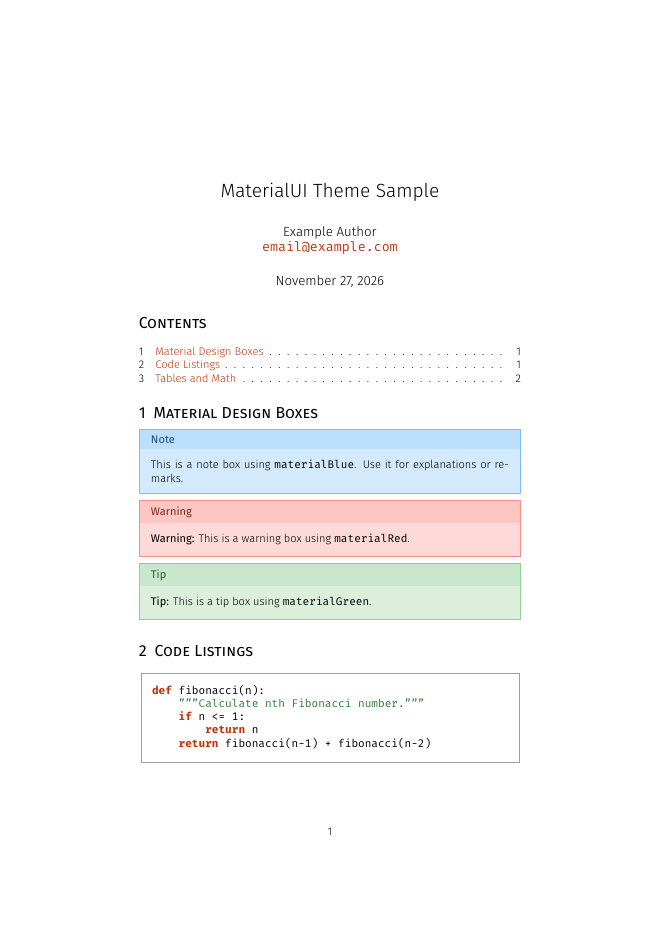

# MaterialUI LaTeX Theme

A clean, modern LaTeX theme inspired by Material Design principles and the Metropolis Beamer theme.



## Features

- **Material Design colour palette**: every text colour reads at 4.5:1 or more on its background (WCAG 2.2 AA). The lowest is 4.91:1, the title of an orange box. `make check` tests this with `contrast.py`
- **Modern Typography**: Uses Fira Sans Light for regular text, Fira Sans for bold, and Fira Mono for code
- **Mathematics Support**: Includes amsthm, mathtools, and unicode-math with FiraMath
- **Clean Code Listings**: Syntax highlighting with Material colors and consistent borders
- **Custom Box Generator**: Create styled mdframed environments with any color
- **Professional Styling**: Clean section formatting and improved spacing

## Requirements

- XeLaTeX (for font support)
- Fira Sans font family (Light and Regular weights)
- Fira Mono font
- FiraMath font

## Run it

Copy `theme.sty` to your LaTeX project directory and include it in your document:

```latex
\documentclass[10pt,a4paper]{article}
\usepackage{theme}
```

## Colour palette

The theme includes these Material Design colours for fills, rules and box accents:

- **materialBlue**: `#2196F3`
- **materialIndigo**: `#3F51B5`
- **materialGreen**: `#4CAF50`
- **materialOrange**: `#FF9800`
- **materialRed**: `#F44336`
- **materialGrey**: `#9E9E9E`
- **materialLightGrey**: `#F5F5F5`
- **materialDarkGrey**: `#616161`

Text uses darker shades, so it stays readable on white:

- **materialOrangeText**: `#BF360C` (Deep Orange 900), for links and code keywords. 5.60:1 on white.
- **materialGreenText**: `#2E7D32` (Green 800), for code comments, strings and option names. 5.13:1 on white.

A box title is its colour mixed with 45% black (`#3!55!black`), on a 30% tint of the same colour.

## Usage

### Material Design Boxes

Create custom styled boxes using the `\definematerialbox` command:

```latex
\documentclass[10pt,a4paper]{article}
\usepackage{theme}

% Define custom box styles
\definematerialbox{notestyle}{Note}{materialBlue}
\definematerialbox{warningstyle}{Warning}{materialRed}
\definematerialbox{tipstyle}{Tip}{materialGreen}

\begin{document}

\begin{mdframed}[style=notestyle]
This is a note with a blue accent.
\end{mdframed}

\begin{mdframed}[style=warningstyle]
\textbf{Warning:} Important information here.
\end{mdframed}

\end{document}
```

**Command Syntax:**
```latex
\definematerialbox{stylename}{Title}{color}
```

- `stylename`: Unique name for the style (e.g., `notestyle`)
- `Title`: Text shown in the box header (e.g., `Note`)
- `color`: Any Material Design color or custom xcolor (e.g., `materialBlue`)

### Code Listings

The theme automatically configures code listings with borders and Material colors:

```latex
\begin{lstlisting}[language=Python]
def fibonacci(n):
    if n <= 1:
        return n
    return fibonacci(n-1) + fibonacci(n-2)
\end{lstlisting}
```

### Mathematics

The theme includes amsthm, mathtools, and unicode-math:

```latex
% Theorem environments
\newtheorem{theorem}{Theorem}
\newtheorem{lemma}{Lemma}

\begin{theorem}
For all $n \in \mathbb{N}$, we have $\sum_{i=1}^{n} i = \frac{n(n+1)}{2}$.
\end{theorem}

% Math with mathtools
\begin{equation}
\int_{-\infty}^{\infty} e^{-x^2} dx = \sqrt{\pi}
\end{equation}
```

## Example Document

See `sample.tex` for a complete example demonstrating all features.

## Status

Complete, and archived on 27 November 2026. See [STATUS.md](STATUS.md).

## Licence

MIT. See [LICENSE](LICENSE).
